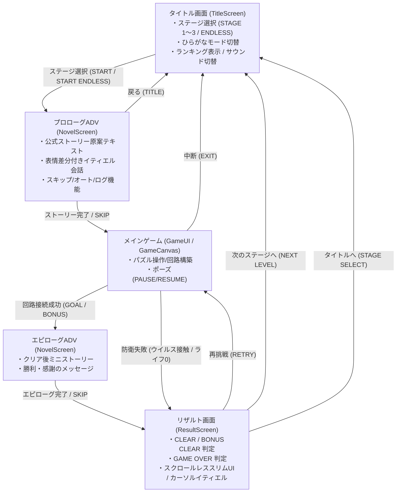

# teThieL

中央大学国際情報学部 (iTL) 公式キャラクター「イティエル」をモチーフにした逆テトリス型アクションパズルゲーム。  
企画書「逆テトリス型 回路つなぎパズル」準拠。  
サイバー攻撃の魔の手が迫る市ヶ谷田町キャンパスを舞台に、最下部「START」からブロックを積み上げて回路を繋ぎ、ウイルスに追いつかれないようイティエルを最上部の「GOAL」へと導く。

## 目次

- [概要](#概要)
- [ゲームシステム](#ゲームシステム)
- [ステージ構成](#ステージ構成)
- [画面遷移](#画面遷移)
- [操作方法](#操作方法)
- [コマンド一覧](#コマンド一覧)
- [ディレクトリ構造](#ディレクトリ構造)
- [テスト・品質保証システム](#テスト品質保証システム)
- [技術仕様](#技術仕様)
- [関連ドキュメント](#関連ドキュメント)

## 概要

- ジャンル: 逆テトリス型アクションパズル
- コンセプト: 積んでつなげるアクションパズル。ウイルスに追いつかれない緊張感とクリア時の達成感
- デザイン: 学部のテーマカラー (赤) をベースとしたクリムゾンサイバー調UIと、リアルなゲーミングキートップUI
- 対象プラットフォーム: 展示用PC・Webブラウザ (タッチパネル・ノートPC解像度・低スペック端末対応)
- アクセシビリティ: 未就学児から大人まで楽しめる「ひらがなモード / 通常モード」ワンクリック切り替え対応

## ゲームシステム

1. **下から上へ回路を繋ぎ、イティエルが登る**  
   上から落ちてくるミノを積み上げ、最下部「START」から回路を接続。イティエルは繋がった回路を足場にして上へと登っていき、最上部ミノが白く光ります。
2. **下からせりあがるウイルス感染 (2ミノ待機・直線警戒線)**  
   ゲーム開始時、2ミノ配置完了するまでウイルスは待機します。2ミノ設置後、最下行から順に横一列 (行単位) で直線状のウイルス警戒ラインがせりあがってきます。せりあがった感染行にイティエルが呑まれるとライフを喪失します (※従来の回路辿り型感染もコード内に保持されています)。
3. **GOAL到達時の新規ミノ停止 & BONUSゴール**  
   回路の最上部が最上部「GOAL」ライン (行2以下) に到達した瞬間に、新規ミノの出現が停止し、イティエルの登頂へと移行します。右端の「BONUS」エリアへ接続すると高得点のボーナスクリアとなります。
4. **ボーナス星 (★)**  
   ステージ上の空中に浮遊する星アイテムをミノで回収すると、ボーナスカウントとスコアが加算されます (スピード重視のため控えめな配点)。
5. **トゲ障害物とミノ破壊トラップ**  
   フィールド上にトゲトゲの危険な障害物が配置されています。イティエルのいる通電回路に接続していないミノがトゲ障害物に接触して接地すると、トラップが作動してミノが粉々に破壊され、ライフが減少します。すでに通電回路と接続しているミノであれば、トゲの脇に安全に足場を組むことができます。
6. **ボムスキル & ホールド**  
   `B` キーまたはボタンで周囲3x3マスの障害物・ブロックを吹き飛ばすボムスキル (サイバー爆発エフェクト・破片パーティクル・UI即時連動)、およびミノを1つキープできるホールド (`C` キー) を搭載。
7. **エピローグシナリオ (会話ADV)**  
   各ステージクリア後にイティエルとの会話ミニストーリーが展開。公式原案ストーリーテキスト、表情差分の0.2秒クロスフェード演出、GPU事前常駐キャッシュに対応。
8. **タイトル画面インタラクション (隠しポーズ機能)**  
   タイトル画面右側の立ち絵イティエルをタッチ・連打・長押しすることで、表情ポーズ (DEFAULT / WINK / NIYA / KIRA) を自由に切り替え可能。
9. **ひらがなモード (キッズモード)**  
   タイトル画面のトグルスイッチでいつでも切り替え可能。タイトル、左右HUD、キーボードガイド、Canvas上文字 (GOAL/ゴール, BONUS/ボーナス, CLIMB/たかさ, PAUSED/ストップ)、ADV会話、リザルト画面まで全UIが未就学児向けのやさしいひらがな表記に対応。
10. **独立サウンド設定 (BGM / SE)**  
    オプション画面 (OPTION) にて、BGM 音量および SE 音量を 0%〜100% で独立調整可能。
11. **スコアシステム & ルール**  
    - クリアタイムに応じた時間マイナス補正 (早くクリアするほど高得点)
    - 置いたミノ数が少ないほどプラス評価 (ミノ節約ボーナス)
    - 横一列揃っても消去や回復等のプラス効果はありません (回路接続のみに集中)
12. **全画面・スクロールレス設計**  
    ゲームプレイ画面およびクリア/リザルト画面は、ノートPC (720p/768p/780p) 環境でも一切スクロールバーが出ない高密度スリムレイアウトに最適化。

## ステージ構成

| ステージ | サブタイトル | 感染速度 | 特徴 |
| :--- | :--- | :--- | :--- |
| **STAGE 1** | 入門・回路接続 | 4500ms | 初心者・子ども向け。中央ルートが開けたやさしい設計 (障害物4マス、星4個) |
| **STAGE 2** | サイバー迂回ルート | 1400ms | トゲ障害物を回避しながら迂回ルートを構築する標準難易度 (障害物18マス、星5個) |
| **STAGE 3** | 最終防衛戦 | 1600ms | サーバーコア中枢の最終決戦。縦2列の直線抜け道を遮断し、S字クランクを登る立体パズル (障害物21マス、星5個) |
| **ENDLESS** | 無限クライミング | 3800ms〜加速 | 天井のないサイバー空間をどこまでも登り続けるサバイバルモード。登った総高度 (m) を競う |

## 画面遷移

アプリケーションは4つの主要画面で構成され、各画面間の遷移は以下の通りです。



## 操作方法

| 操作内容 | キーボード入力 | 画面タッチ / マウス |
| :--- | :--- | :--- |
| 即置き (ハードドロップ) | `↑` または `Space` | `⚡ DROP` ボタン |
| 左回転 (反時計回り) | `Z` | `↺ ROT L` ボタン |
| 右回転 (時計回り) | `X` / `W` | `↻ ROT R` ボタン |
| 左右移動 | `←` / `→` または `A` / `D` | `◀ LEFT` / `RIGHT ▶` ボタン |
| ソフトドロップ | `↓` または `S` | `▼ DOWN` ボタン |
| ホールド | `C` | `HOLD` ボタン |
| ボム発動 | `1` / `B` | `BOMB!` ボタン |
| 一時停止 | `P` / `Escape` | `PAUSE` ボタン |

## コマンド一覧

| コマンド | 説明 |
| :--- | :--- |
| `pnpm dev` | ローカル開発サーバーを起動する (デフォルト: http://localhost:5180/) |
| `pnpm build` | TypeScript型検査および本番用静的バンドルをビルドする |
| `pnpm preview` | ビルド成果物をローカルでプレビュー実行する |
| `pnpm test` | Node.js 標準テストランナーで全自動テストを実行する (レイアウト、ソルバー、進入路検証) |
| `pnpm generate:stages` | constants.ts からステージマップ画像 (SVG) および確認用HTMLギャラリーを生成する |
| `pnpm format` | Biomeを用いてプロジェクト全体のコードフォーマットを実行する |
| `pnpm lint` | Biomeを用いて静的コード解析を実行する |

## ディレクトリ構造

```
tethiel/
├── docs/
│   └── GAME_DESIGN.md         # ゲーム詳細仕様書・要件ドキュメント
├── output/
│   └── stages/                # 自動生成されたステージマップSVGおよびindex.htmlギャラリー (.gitignore対象)
├── public/                    # 静的アセット
├── scripts/
│   ├── extract_title_visual.js # PSDからタイトルキービジュアルを抽出するスクリプト
│   ├── generate_favicon.js    # イティエル画像をもとにfavicon(ICO/PNG)を生成するスクリプト
│   ├── generate_stage_images.mjs # constants.tsからステージ画像とHTMLビューアを自動生成するスクリプト
│   └── process_cursor.js      # イティエルカーソル画像のセンタリング・リサンプリングスクリプト
├── src/
│   ├── assets/
│   │   ├── audio/             # BGM・効果音ファイル (WAV/MP3)
│   │   ├── character/         # 自機歩行スプライトおよび立ち絵イラスト (通常、ウインク、ニヤリ、キラキラ)
│   │   ├── cursor/            # イティエルカスタムマウスカーソル画像
│   │   ├── obstacle/          # トゲ障害物ウイルス画像 (virus.png)
│   │   ├── story/             # ノベルゲーム用表情差分立ち絵イラスト8種
│   │   └── visual/            # タイトル画面用キービジュアル画像
│   ├── audio/
│   │   ├── audioContext.ts    # Web Audio API 共通コンテキスト管理
│   │   ├── bgmManager.ts      # BGMシームレスループ・音量制御モジュール
│   │   └── soundSystem.ts     # シンセ効果音およびSE再生制御モジュール
│   ├── components/
│   │   ├── modals/            # 設定・ランキング・クレジット等のモーダル群 (OptionModal, RankingModal, CreditModal)
│   │   ├── ui/                # 共通UIコンポーネント (CyberCard, CyberButton, CyberBadge, UIModeToggle)
│   │   ├── GameCanvas.tsx     # START/GOAL、回路パス、登るイティエル、黒色感染を描画するCanvas
│   │   ├── GameUI.tsx         # 企画書5,6p準拠の3カラムHUD (ハート5つ、ステータス、立ち絵枠、操作説明)
│   │   ├── Keycap.tsx         # 2重立体構造のリアルなキートップコンポーネント
│   │   ├── KeyboardGuide.tsx  # QWERTY配列と引き出し線・矢印による操作説明コンポーネント
│   │   ├── NovelScreen.tsx    # ノベルゲー風ミニストーリーADVコンポーネント (プロローグ・エピローグ共通)
│   │   ├── ResultScreen.tsx   # 通常/ボーナスクリア・リザルト画面 (スクロールレス最適化)
│   │   └── TitleScreen.tsx    # タイトル画面 (ステージ選択、ひらがなモード切替トグル、立ち絵ポーズ切り替え)
│   ├── config/
│   │   └── gameFlags.ts       # ユーザー設定フラグ (ドット絵/立ち絵、ストーリー表示ON/OFF)
│   ├── context/
│   │   └── UIModeContext.tsx  # 通常モード / ひらがなモードのグローバルコンテキスト
│   ├── data/
│   │   ├── epilogues.ts       # 各ステージクリア後のエピローグADVシナリオデータ
│   │   ├── stages.ts          # 各ステージのブロック配置・トゲ・星定義
│   │   ├── storyData.ts       # 公式ストーリー原案テキスト準拠シナリオデータ
│   │   └── uiTexts.ts         # 通常/ひらがなモードの多言語辞書データ
│   ├── game/
│   │   ├── constants.ts       # グリッド(12x22)、STAGE 1〜3 / ENDLESS設定、START/GOAL定数
│   │   ├── engine.ts          # BFS回路探索・登頂・感染・勝敗判定ゲームエンジン
│   │   ├── input.ts           # キーボード入力判定(日本語IME対策)およびアクション実行
│   │   └── tetromino.ts       # 7-bag生成、壁蹴り回転、ゴースト計算
│   ├── types/
│   │   ├── game.ts            # ゲームエンティティ・状態の型定義
│   │   └── story.ts           # ストーリーシナリオ・表情の型定義
│   ├── utils/
│   │   ├── overflowChecker.ts # 画面はみ出し・ビューポート超過を検知・監視するユーティリティ
│   │   ├── preloadAssets.ts   # ゲーム・ストーリー用画像アセットの事前読み込み・デコード管理
│   │   └── url.ts             # ステージURLパラメータ解析およびクリーンアップ
│   ├── App.tsx                # 画面遷移・全体状態管理 (全画面スクロール抑止コンテナ)
│   ├── index.css              # クリムゾンサイバー調Vanilla CSSスタイルシート
│   └── main.tsx               # アプリケーションエントリーポイント
├── tests/
│   ├── bomb.test.mjs          # ボムスキルの破壊判定・即時UI連動・ライフサイクル単体テスト
│   ├── overflow.test.mjs      # CSS制約、高さバジェット、縦直通遮断検証テスト
│   ├── solvability.test.mjs   # 静的AIによるクリア可能性・全ミノ進入路検証テスト
│   ├── stage_solver.mjs       # 貪欲階段クライミング法によるヘッドレスAIシミュレータ
│   └── test_reachability_all.mjs # 全ミノの地面到達可能性判定モジュール
├── biome.json                 # Biome設定ファイル
├── index.html                 # DotGothic16 / Press Start 2P フォント設定
├── package.json               # 依存関係およびスクリプト定義
├── tsconfig.json              # TypeScriptコンパイラ設定
└── vite.config.ts             # Vite設定
```

## テスト・品質保証システム

Node.js 標準テストランナー (`node --experimental-strip-types --test`) を採用し、外部ライブラリ依存ゼロで高速 (約400ms) に全16件の品質検証を実行します。

1. **ボムスキル完全性・ライフサイクル検証 (`bomb.test.mjs`)**:
   - 初期所持数、消費・枯渇サイクル、3x3破壊ロジック (障害物・通常ブロック・感染ブロック)。
   - スコア加算とUIステート (`onStatsChange`) の即時同期。
   - 爆発エフェクトデータ生成およびキーボード入力マッピング。
2. **画面オーバーフロー・スクロール抑止検証 (`overflow.test.mjs`)**:
   - `html, body, #root` の `overflow: hidden` 制約。
   - ノートPC解像度 (720p, 768p, 780p) におけるリザルト画面の高さバジェット計算 (はみ出し余白100px以上の確保)。
3. **直通ライン遮断検証**:
   - STAGE 3 において、置くだけで勝てるような縦2列の完全素通しラインが存在しないことの検証。
   - 連続する空き高さが8行以内であることの保証。
4. **全ミノ地上到達可能性検証**:
   - 全ステージにおいて、全ての基本ミノ (I, O, T, L, J, S, Z) が上空 (y=0) から障害物に遮られず地面まで落下・進入できる幾何学的保証。
5. **静的AIによるソルバビリティ検証**:
   - 貪欲階段クライミングAIが各ステージを自動プレイし、制限手以内・感染到達前に GOAL (row <= 2) へ到達できることの自動検証。

## 技術仕様

- フレームワーク: Vite + React 19 + TypeScript
- レンダリング: HTML5 Canvas 2D Context (60fps requestAnimationFrame)
- サウンド: Web Audio API (AudioBufferSourceNode によるBGMシームレスループ制御 + シンセサイザー合成音SE)
- UI / カーソル: クリムゾンサイバー調デザイン、イティエルドット絵カスタムカーソル (中心ホットスポット 16 16)
- フォント: DotGothic16, Press Start 2P
- コード品質管理: Biome 1.9.4
- テストランナー: Node.js 組み込み Test Runner (node:test, node:assert)

## 関連ドキュメント

- [ゲーム詳細設計書 (GAME_DESIGN.md)](docs/GAME_DESIGN.md): 逆テトリス型回路パズルのゲームルール、配点、ステージ仕様、ウイルス感染仕様の詳細ドキュメント
- [開発引継ぎ資料 (HANDOVER.md)](docs/HANDOVER.md): 直近の機能改修実績、アーキテクチャ、品質保証体制、開発時の注意点・ロードマップをまとめた引継ぎドキュメント
